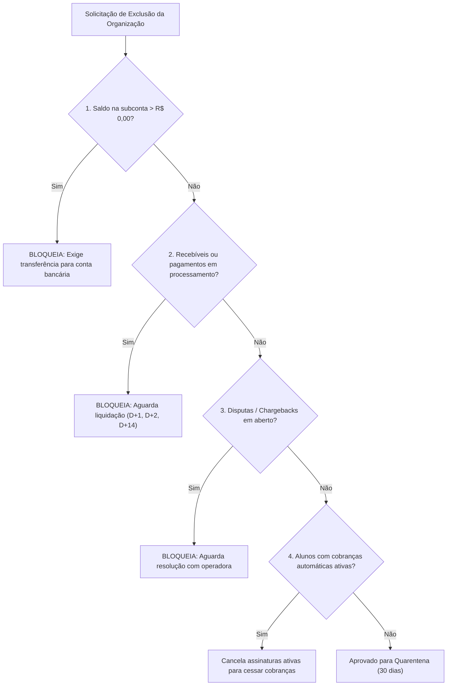

# 24. Diretrizes de Exclusão de Conta, Encerramento e Conformidade LGPD

> **Documento de referência para arquitetura, compliance legal e roadmap de produto.**  
> Este guia detalha o enquadramento jurídico sob a LGPD (Lei 13.709/2018), as obrigações legais concorrentes (BACEN, Receita Federal, Código Civil e CLT) e a esteira técnica para exclusão da **Organização (Tenant)** e de **Usuários Associados** (Alunos, Professores e Equipe).

---

## 1. Enquadramento Legal sob a LGPD (Lei 13.709/2018)

### 1.1. Papéis Jurídicos: Controlador vs. Operador
* **GestaraHub:** Atua como **Operador** dos dados perante a plataforma SaaS (processa dados em nome do cliente).
* **A Academia / Estúdio (Organização):** É a **Controladora** dos dados pessoais de seus alunos, clientes e prestadores/professores. O titular do dado tem vínculo contratual direto com o espaço.

### 1.2. O Mito da "Exclusão Imediata e Total"
Existe um equívoco comum no mercado de que a LGPD concede ao usuário o direito de exigir que o banco de dados seja imediatamente e integralmente apagado (`DELETE FROM`). 

Embora o **Artigo 18, inciso VI** preveja o direito à eliminação dos dados tratados com base no consentimento, o **Artigo 16 da LGPD** estabelece categoricamente que **a plataforma é autorizada e obrigada por lei a conservar dados** para:
1. **Cumprimento de obrigação legal ou regulatória** pelo controlador (Art. 16, I);
2. **Execução de contrato e cobrança de obrigações pendentes** (Art. 7º, V);
3. **Exercício regular de direitos em processo judicial, administrativo ou arbitral** (Art. 7º, VI e Art. 16, IV);
4. **Uso exclusivo do controlador, vedado o acesso por terceiros, desde que anonimizados os dados** (Art. 16, IV).

### 1.3. Legislações Concorrentes que Exigem Retenção Obrigatória

| Órgão / Legislação | O que exige reter | Prazo Obrigatório | Fundamento |
| :--- | :--- | :--- | :--- |
| **BACEN & COAF** (Res. 3.978 e 4.753) | Registros de abertura de conta, histórico de transações, saques e KYC. | **5 a 10 anos** | Prevenção a fraudes e lavagem de dinheiro em subcontas de pagamento. |
| **Código Tributário Nacional** (CTN, Arts. 173 e 174) | Recibos, lançamentos de receita/despesa, comprovantes e notas fiscais. | **5 anos** | Prazo decadencial e prescricional de fiscalização da Receita Federal. |
| **Código Civil Brasileiro** (CCB, Art. 206) | Contratos de prestação de serviço, cobranças, termos de responsabilidade. | **3 a 5 anos** | Prescrição de pretensão de cobrança de dívidas e reparação civil. |
| **CLT e Legislação Previdenciária** | Folha de repasses a instrutores, presenças e registros de aulas dadas. | **5 anos** (com limite de 2 anos pós-rescisão) | Defesa em reclamações trabalhistas e auditoria do Ministério do Trabalho. |
| **Marco Civil da Internet** (Lei 12.965/14, Art. 15) | Logs de auditoria, IPs e data/hora de eventos de autenticação e transações. | **6 meses** | Rastreabilidade de ilícitos cibernéticos. |

---

## 2. Cenário A: Exclusão da Organização / Espaço (Tenant PJ)

A exclusão da organização representa o encerramento do contrato B2B da academia com o GestaraHub.

### 2.1. Travas Pré-Exclusão (*Pre-flight Checks*)
1. **Saldo Disponível na Subconta:** Se houver saldo positivo (ex.: R$ 350,00 no Asaas), a exclusão é impedida. O dono deve realizar a transferência para sua conta bancária antes de prosseguir.
2. **Eventos Financeiros em Processamento:** Boletos emitidos aguardando compensação, Pix pendentes ou cartões a liquidar devem ser processados ou cancelados.
3. **Disputas e Chargebacks:** Conta não pode ser deletada com contestações de cartão em aberto.
4. **Assinaturas Recorrentes de Alunos:** O sistema deve disparar o cancelamento imediato de todas as recorrências ativas para evitar débitos indevidos.
5. **Assinatura do GestaraHub:** Encerramento imediato da renovação do plano Pro/Expansão.

### 2.2. Esteira em 3 Fases

* **Fase 1 — Bloqueio Operacional Imediato:**
  * O status da organização muda para `pending_deletion`.
  * Todas as sessões ativas são revogadas imediatamente.
  * O acesso via login é desativado para todos os usuários daquela organização.
* **Fase 2 — Quarentena (*Soft Delete* de 30 dias):**
  * O tenant permanece congelado por 30 dias para permitir conciliação financeira final e arrependimento assistido via suporte.
* **Fase 3 — Expuração e Anonimização (*Hard Delete* Seletivo):**
  * **Eliminados fisicamente:** Fotos, horários, grades de aulas, recados, preferências e dados puramente operacionais.
  * **Anonimizados e arquivados por 5 anos:** Transações financeiras, notas emitidas e logs de auditoria (para fins fiscais e bancários exigidos por lei).

---

## 3. Cenário B: Exclusão de Usuários Associados à Organização

Quando uma pessoa física vinculada ao espaço solicita o "direito ao esquecimento" ou desativação:

### 3.1. Aluno / Cliente
* **Travas de Bloqueio:**
  * Aluno com mensalidades em aberto ou faturas atrasadas não tem direito à eliminação imediata de cobranças (base: Execução de Contrato e Cobrança de Dívidas).
* **Solução Técnica (Direito ao Esquecimento via Pseudonimização):**
  * Dados cadastrais e pessoais supérfluos são **eliminados permanentemente**: foto de perfil, telefone, e-mail, restrições médicas, histórico de avaliações físicas e endereço.
  * Dados financeiros históricos são **anonimizados**: o registro de pagamento continua existindo para o caixa da academia bater, mas o nome é mascarado para `Aluno Anonimizado #ID` e o CPF é destruído (`***.***.***-**`).
  * As matrículas e cobranças futuras são canceladas.
  * **CPF (22/10/2026):** o do aluno (`clients.cpf`) e o do responsável financeiro (`guardians[].cpf`) existem só para a cobrança online (o parceiro de pagamentos exige o CPF de quem paga). Na anonimização os dois são destruídos.

### 3.2. Professor / Instrutor
* **Travas de Bloqueio:**
  * **Titularidade de Turmas:** O sistema impede a inativação se o professor for titular de turmas ativas sem que antes outro instrutor seja definido como responsável.
  * **Repasses Financeiros Pendentes:** Aulas ministradas no mês sem acerto efetuado.
* **Solução Técnica:**
  * O acesso é revogado imediatamente.
  * O histórico de presença em aulas que ele ministrou é preservado para comprovação jurídica e trabalhista perante a CLT (prazo de 5 anos).
  * Informações de contato pessoal (endereço, telefone) são arquivadas de forma restrita ou eliminadas.

### 3.3. Staff / Atendente / Gerente
* **Travas de Bloqueio:**
  * Nenhuma trava financeira direta, exceto prestação de contas de caixa físico se houver.
* **Solução Técnica:**
  * Inativação de credenciais de login.
  * **Preservação de Logs de Auditoria:** O histórico de quem realizou ações operacionais e financeiras (ex.: `"Carlos (Inativo) registrou pagamento em dinheiro"`) **deve ser preservado** para cumprimento do Marco Civil da Internet e auditoria antifraude.

---

## 4. Matriz Resumo: Ações por Papel

| Papel | Travas Obrigatórias | O que é Eliminado | O que é Anonimizado / Preservado |
| :--- | :--- | :--- | :--- |
| **Dono (Tenant)** | Saldo > 0, pagamentos em liquidação, chargebacks abertos. | Turmas, agendas, planos, configurações e preferências (após 30 dias). | Transações contábeis e notas fiscais por 5 anos (BACEN/CTN). |
| **Aluno** | Faturas ativas a vencer, inadimplência em aberto. | Foto, telefone, e-mail, biometria, anamnese, observações. | Histórico de pagamentos já realizados (com nome pseudonimizado). |
| **Professor** | Turmas sob titularidade, comissões pendentes. | Senha, credenciais e contatos pessoais particulares. | Histórico de chamadas e aulas ministradas (CLT / 5 anos). |
| **Staff / Gerente** | Nenhuma. | Senha e credenciais de acesso. | Trilha de auditoria das ações realizadas no sistema (Marco Civil). |

---

## 5. Diretrizes para Interface Futura (Zona de Perigo / *Danger Zone*)

Quando a funcionalidade for implementada na interface:
1. **Localização:** Em [`/settings`](../../apps/web/src/features/settings), em uma aba ou card dedicado com visual destrutivo (`border-destructive/40 bg-destructive/5`).
2. **Permissão Restrita:** Exclusiva para o perfil `owner` (Proprietário).
3. **Pré-verificação em tela:** Se houver saldo ou pendências na subconta, o card deve exibir um estado de bloqueio com link direto para a tela de transferência/saque.
4. **Confirmação Estrita:** Exigir que o usuário digite o nome exato da organização (em caixa alta) e confirme sua senha antes de agendar a exclusão.

## 6. Rotas públicas: só dados mascarados (decisão do usuário, 30/10/2026)

### Decisao
Toda página aberta sem login (link que circula por WhatsApp: fatura da cobrança `/p/c/<cobrança>`, pagamento `/p/<código>` e comprovante, termo do responsável `/consent/minor/<aluno>`) recebe do servidor **só dados pessoais mascarados**. Máscaras únicas em `@gestarahub/core/privacy`:
- nome: o primeiro inteiro e as iniciais do resto, sem "de", "da", "dos" ("Ana Souza Lima" vira "Ana S. L.");
- CPF: só os dígitos do meio, padrão do gov.br ("***.982.247-**");
- nascimento: só o ano ("**/**/2015");
- telefone: só os 4 últimos dígitos.

Também valem nessas páginas:
- Formulário não vem preenchido com dado pessoal: no termo do responsável, quem assina digita o próprio nome e telefone (o nome digitado vai para a prova do consentimento).
- Página pública não grava no cadastro: o CPF digitado na fatura vale só para aquela cobrança.

### Contexto
Quem tem o link nem sempre é o aluno: o link é encaminhado, fica no histórico do WhatsApp e no navegador. Antes, a fatura mostrava o nome completo do aluno, e o termo mostrava o nome completo e o nascimento da criança e o telefone do responsável.

### Escopo
- **Código:** `services/server/paymentPage.ts` (`loadChargeInvoice`) e `services/legalConsent/minorConsentActions.ts` (`getPublicMinorConsentDetailsAction`). A página `/p/<código>` e o comprovante já não mostravam dados do aluno.
- **Testes:** `packages/core/test/privacy.test.ts` e `apps/web/src/services/server/__tests__/publicRoutesPrivacy.db.test.ts` (o que sai do servidor não contém o nome inteiro, o CPF, o telefone nem a data completa).
- **Regra do projeto:** está em `CLAUDE.md` e `AGENTS.md`, seção 3, para toda rota pública nova.

### Alternativas
- **Não mostrar nada do aluno:** descartado. Quem paga ou assina precisa reconhecer de quem é a cobrança ou o termo.
- **Mascarar só na tela:** descartado. O dado inteiro chegaria ao navegador de quem só tem o link.
