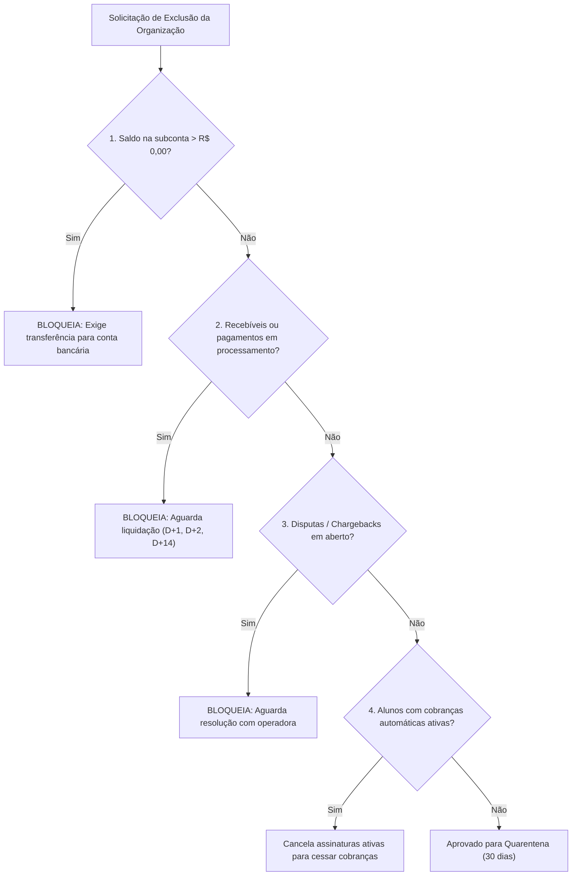

# 24. Diretrizes de Exclusão de Conta, Encerramento e Conformidade LGPD

Data: 2026-10-24 (ampliado em 2026-10-30 e 2026-11-16) · Status: Decidido (rotas públicas §6 feitas; exclusão definitiva, encerramento da subconta e Zona de Perigo §5/§7 como proposta para depois) · Código: `apps/web/src/features/settings`, `apps/web/src/services/onlinePayments/`, `apps/admin/src/app/(panel)/privacy/`, `apps/web/src/features/landing/components/legal-documents.tsx` · Testes: `apps/web/src/services/server/__tests__/publicRoutesPrivacy.db.test.ts`, `apps/admin/src/app/(panel)/privacy/privacy.db.test.ts`

> **Documento de referência para arquitetura, compliance legal e roadmap de produto.**  
> Este guia detalha o enquadramento jurídico sob a LGPD (Lei 13.709/2018), as obrigações legais concorrentes (BACEN, Receita Federal, Código Civil e CLT) e a esteira técnica para exclusão da **Organização (Tenant)**, **encerramento de subconta de pagamentos** e **Usuários Associados** (Alunos, Professores e Equipe).

---

## 1. Enquadramento Legal sob a LGPD (Lei 13.709/2018)

### 1.1. Papéis Jurídicos: Controlador vs. Operador
* **GestaraHub:** Atua como **Operador** dos dados perante a plataforma SaaS (processa dados em nome do cliente).
* **A Academia / Estúdio (Organização):** É a **Controladora** dos dados pessoais de seus alunos, clientes e prestadores/professores. O titular do dado tem vínculo contratual direto com o espaço.

### 1.2. O Mito da "Exclusão Imediata e Total"
Existe um equívoco comum no mercado de que a LGPD concede ao usuário o direito de exigir que o banco de dados seja imediatamente e integralmente apagado (`DELETE FROM`). 

Embora o **Artigo 18, inciso VI** preveja o direito à eliminação dos dados tratados com base no consentimento, o **Artigo 16 da LGPD** estabelece categoricamente que **a plataforma é autorizada e obrigada por lei a conservar dados** para:
1. **Cumprimento de obrigação legal ou regulatória** pelo controlador (Art. 16, I);
2. **Execução de contrato e cobrança de obrigações pendentes** (Art. 7º, V);
3. **Exercício regular de direitos em processo judicial, administrativo ou arbitral** (Art. 7º, VI e Art. 16, IV);
4. **Uso exclusivo do controlador, vedado o acesso por terceiros, desde que anonimizados os dados** (Art. 16, IV).

### 1.3. Legislações Concorrentes que Exigem Retenção Obrigatória

| Órgão / Legislação | O que exige reter | Prazo Obrigatório | Fundamento |
| :--- | :--- | :--- | :--- |
| **BACEN & COAF** (Res. 3.978 e 4.753) | Registros de abertura de conta, histórico de transações, saques e KYC. | **5 a 10 anos** | Prevenção a fraudes e lavagem de dinheiro em subcontas de pagamento. |
| **Código Tributário Nacional** (CTN, Arts. 173 e 174) | Recibos, lançamentos de receita/despesa, comprovantes e notas fiscais. | **5 anos** | Prazo decadencial e prescricional de fiscalização da Receita Federal. |
| **Código Civil Brasileiro** (CCB, Art. 206) | Contratos de prestação de serviço, cobranças, termos de responsabilidade. | **3 a 5 anos** | Prescrição de pretensão de cobrança de dívidas e reparação civil. |
| **CLT e Legislação Previdenciária** | Folha de repasses a instrutores, presenças e registros de aulas dadas. | **5 anos** (com limite de 2 anos pós-rescisão) | Defesa em reclamações trabalhistas e auditoria do Ministério do Trabalho. |
| **Marco Civil da Internet** (Lei 12.965/14, Art. 15) | Logs de auditoria, IPs e data/hora de eventos de autenticação e transações. | **6 meses** | Rastreabilidade de ilícitos cibernéticos. |

---

## 2. Cenário A: Exclusão da Organização / Espaço (Tenant PJ)

A exclusão da organização representa o encerramento do contrato B2B da academia com o GestaraHub.

### 2.1. Travas Pré-Exclusão (*Pre-flight Checks*)
1. **Saldo Disponível na Subconta:** Se houver saldo positivo (ex.: R$ 350,00 no Asaas), a exclusão é impedida. O dono deve realizar a transferência para sua conta bancária antes de prosseguir.
2. **Eventos Financeiros em Processamento:** Boletos emitidos aguardando compensação, Pix pendentes ou cartões a liquidar devem ser processados ou cancelados.
3. **Disputas e Chargebacks:** Conta não pode ser deletada com contestações de cartão em aberto.
4. **Assinaturas Recorrentes de Alunos:** O sistema deve disparar o cancelamento imediato de todas as recorrências ativas para evitar débitos indevidos.
5. **Assinatura do GestaraHub:** Encerramento imediato da renovação do plano Pro/Expansão.

### 2.2. Esteira em 3 Fases

* **Fase 1 — Bloqueio Operacional Imediato:**
  * O status da organização muda para `pending_deletion`.
  * Todas as sessões ativas são revogadas imediatamente.
  * O acesso via login é desativado para todos os usuários daquela organização.
* **Fase 2 — Quarentena (*Soft Delete* de 30 dias):**
  * O tenant permanece congelado por 30 dias para permitir conciliação financeira final e arrependimento assistido via suporte.
* **Fase 3 — Expuração e Anonimização (*Hard Delete* Seletivo):**
  * **Eliminados fisicamente:** Fotos, horários, grades de aulas, recados, preferências e dados puramente operacionais.
  * **Anonimizados e arquivados por 5 anos:** Transações financeiras, notas emitidas e logs de auditoria (para fins fiscais e bancários exigidos por lei).

---

## 3. Cenário B: Exclusão de Usuários Associados à Organização

Quando uma pessoa física vinculada ao espaço solicita o "direito ao esquecimento" ou desativação:

### 3.1. Aluno / Cliente
* **Travas de Bloqueio:**
  * Aluno com mensalidades em aberto ou faturas atrasadas não tem direito à eliminação imediata de cobranças (base: Execução de Contrato e Cobrança de Dívidas).
* **Solução Técnica (Direito ao Esquecimento via Pseudonimização):**
  * Dados cadastrais e pessoais supérfluos são **eliminados permanentemente**: foto de perfil, telefone, e-mail, restrições médicas, histórico de avaliações físicas e endereço.
  * Dados financeiros históricos são **anonimizados**: o registro de pagamento continua existindo para o caixa da academia bater, mas o nome é mascarado para `Aluno Anonimizado #ID` e o CPF é destruído (`***.***.***-**`).
  * As matrículas e cobranças futuras são canceladas.
  * **CPF (22/10/2026):** o do aluno (`clients.cpf`) e o do responsável financeiro (`guardians[].cpf`) existem só para a cobrança online (o parceiro de pagamentos exige o CPF de quem paga). Na anonimização os dois são destruídos.
  * **Testes e medidas (31/10/2026):** peso, % de gordura, dor e afins (`student_measurements`) são dado de saúde, sensível na LGPD (art. 11). Entram no "histórico de avaliações físicas" acima: na anonimização são **eliminados**, não pseudonimizados. Já vão na exportação dos dados do espaço (`platform.export_space`, migração 75). A anonimização ainda não está no código; quando entrar, apaga as linhas do aluno nesta tabela.

### 3.2. Professor / Instrutor
* **Travas de Bloqueio:**
  * **Titularidade de Turmas:** O sistema impede a inativação se o professor for titular de turmas ativas sem que antes outro instrutor seja definido como responsável.
  * **Repasses Financeiros Pendentes:** Aulas ministradas no mês sem acerto efetuado.
* **Solução Técnica:**
  * O acesso é revogado imediatamente.
  * O histórico de presença em aulas que ele ministrou é preservado para comprovação jurídica e trabalhista perante a CLT (prazo de 5 anos).
  * Informações de contato pessoal (endereço, telefone) são arquivadas de forma restrita ou eliminadas.

### 3.3. Staff / Atendente / Gerente
* **Travas de Bloqueio:**
  * Nenhuma trava financeira direta, exceto prestação de contas de caixa físico se houver.
* **Solução Técnica:**
  * Inativação de credenciais de login.
  * **Preservação de Logs de Auditoria:** O histórico de quem realizou ações operacionais e financeiras (ex.: `"Carlos (Inativo) registrou pagamento em dinheiro"`) **deve ser preservado** para cumprimento do Marco Civil da Internet e auditoria antifraude.

---

## 4. Matriz Resumo: Ações por Papel

| Papel | Travas Obrigatórias | O que é Eliminado | O que é Anonimizado / Preservado |
| :--- | :--- | :--- | :--- |
| **Dono (Tenant)** | Saldo > 0, pagamentos em liquidação, chargebacks abertos. | Turmas, agendas, planos, configurações e preferências (após 30 dias). | Transações contábeis e notas fiscais por 5 anos (BACEN/CTN). |
| **Aluno** | Faturas ativas a vencer, inadimplência em aberto. | Foto, telefone, e-mail, biometria, anamnese, observações. | Histórico de pagamentos já realizados (com nome pseudonimizado). |
| **Professor** | Turmas sob titularidade, comissões pendentes. | Senha, credenciais e contatos pessoais particulares. | Histórico de chamadas e aulas ministradas (CLT / 5 anos). |
| **Staff / Gerente** | Nenhuma. | Senha e credenciais de acesso. | Trilha de auditoria das ações realizadas no sistema (Marco Civil). |

---

## 5. Diretrizes para Interface Futura (Zona de Perigo / *Danger Zone*)

Quando a funcionalidade for implementada na interface:
1. **Localização:** Em [`/settings`](../../apps/web/src/features/settings), em uma aba ou card dedicado com visual destrutivo (`border-destructive/40 bg-destructive/5`).
2. **Permissão Restrita:** Exclusiva para o perfil `owner` (Proprietário).
3. **Pré-verificação em tela:** Se houver saldo ou pendências na subconta, o card deve exibir um estado de bloqueio com link direto para a tela de transferência/saque.
4. **Confirmação Estrita:** Exigir que o usuário digite o nome exato da organização (em caixa alta) e confirme sua senha antes de agendar a exclusão.

## 6. Rotas públicas: só dados mascarados (decisão do usuário, 30/10/2026)

### Decisao
Toda página aberta sem login (link que circula por WhatsApp: fatura da cobrança `/p/c/<cobrança>`, pagamento `/p/<código>` e comprovante, termo do responsável `/consent/minor/<aluno>`) recebe do servidor **só dados pessoais mascarados**. Máscaras únicas em `@gestarahub/core/privacy`:
- nome: o primeiro inteiro e as iniciais do resto, sem "de", "da", "dos" ("Ana Souza Lima" vira "Ana S. L.");
- CPF: só os dígitos do meio, padrão do gov.br ("***.982.247-**");
- nascimento: só o ano ("**/**/2015");
- telefone: só os 4 últimos dígitos.

Também valem nessas páginas:
- Formulário não vem preenchido com dado pessoal: no termo do responsável, quem assina digita o próprio nome e telefone (o nome digitado vai para a prova do consentimento).
- Página pública não grava no cadastro: o CPF digitado na fatura vale só para aquela cobrança.
- **Exceção controlada (12/11/2026, doc product/29): a inscrição em evento por link** (`/p/e/<código>`) só **cria** o aluno visitante novo e a inscrição, nunca muda um cadastro existente (aluno ativo com o mesmo nome e o mesmo telefone tem a inscrição ligada a ele sem tocar no cadastro; só o telefone não liga, para ninguém ver o nome de outra pessoa na fatura) e não devolve dado de aluno. O ingresso (`/p/i/<código>`) mostra o nome mascarado e não grava nada sem login.
- **Limites contra abuso (30/10/2026, auditoria):** a fatura pública aceita até 6 pedidos de pagamento por IP e cobrança a cada 10 minutos e 15 por cobrança por hora (cada pedido cria um pagamento no parceiro e cancela o anterior). O termo do responsável aceita até 10 envios por IP por hora, texto com tamanho máximo, e **não sobrescreve uma autorização já registrada** (termo impresso ou pelo WhatsApp). O link do termo segue sem prazo (é o id do aluno, impossível de adivinhar); depois de autorizado, deixa de valer.

### Contexto
Quem tem o link nem sempre é o aluno: o link é encaminhado, fica no histórico do WhatsApp e no navegador. Antes, a fatura mostrava o nome completo do aluno, e o termo mostrava o nome completo e o nascimento da criança e o telefone do responsável.

### Escopo
- **Código:** `services/server/paymentPage.ts` (`loadChargeInvoice`) e `services/legalConsent/minorConsentActions.ts` (`getPublicMinorConsentDetailsAction`). A página `/p/<código>` e o comprovante já não mostravam dados do aluno.
- **Testes:** `packages/core/test/privacy.test.ts` e `apps/web/src/services/server/__tests__/publicRoutesPrivacy.db.test.ts` (o que sai do servidor não contém o nome inteiro, o CPF, o telefone nem a data completa).
- **Regra do projeto:** está em `CLAUDE.md` e `AGENTS.md`, seção 3, para toda rota pública nova.

### Alternativas
- **Não mostrar nada do aluno:** descartado. Quem paga ou assina precisa reconhecer de quem é a cobrança ou o termo.
- **Mascarar só na tela:** descartado. O dado inteiro chegaria ao navegador de quem só tem o link.

---

## 7. Especificação futura: Encerrar Subconta Asaas e Apagar Conta GestaraHub

> **Status: Proposta detalhada (guardada para implementar depois, registrada em 16/11/2026).**  
> Hoje o sistema permite apenas **desligar o recebimento online** no app (`onlinePayments.enabled = false`) e **inativar o espaço** no painel admin (`inactivateSpaceAction`). Os fluxos definitivos abaixo dependem de implementação posterior junto com atualização em lote dos textos legais.

### 7.1. Cancelamento / Encerramento da Subconta no Asaas

#### Diferença de cenários
1. **Parar de usar cobrança online (reversível — já existe hoje):**
   - O proprietário saca o saldo em **Recebimentos online → Sacar via Pix** e desliga **`Habilitar cobranças online`** na aba **Configurações**.
   - **Comportamento:** oculta `"Cobrar online"` e links em lembretes/fatura pública, mantendo `gateway_account_id`, `gateway_wallet_id`, `gateway_api_key` e `gateway_status = "approved"` caso volte a usar depois.
2. **Encerramento definitivo da subconta Asaas (futuro — manter ou encerrar conta no parceiro):**
   - **Limite real do Asaas (modelo não-BaaS vs. White Label / BaaS):**
     - Hoje nossas subcontas seguem o modelo **não-BaaS** ([`27-juridico-termos-e-identificacao.md`](27-juridico-termos-e-identificacao.md) item A2): o Asaas envia e-mail de ativação ao titular e ele tem acesso web/app lá.
     - Em **não-BaaS**, a API `DELETE /v3/accounts/{id}` (com chave da conta-pai) **só funciona** se a subconta tiver **menos de 48h** de criação, **nunca tiver feito login**, e exigir Whitelist de IPs + permissão de exclusão nas configurações de segurança do Asaas. Passado esse critério, o encerramento na conta do parceiro só acontece **pelo painel web/atendimento do Asaas**.
     - Caso a conta-pai do GestaraHub seja habilitada futuramente como **White Label / BaaS**, passa a existir `DELETE /v3/myAccount` autenticado com o `access_token` da própria subconta (`gateway_api_key`), enviando `removeReason` (irreversível, também exige Whitelist de IPs).
   - **Pré-checagens obrigatórias (*Pre-flight Checks*) antes de encerrar ou desvincular:**
     1. Consultar saldo em tempo real (`GET /finance/balance` da subconta): exigir saldo disponível e a liberar iguais a **R$ 0,00** (`available === 0` e sem recebíveis futuros/`D+1`/`D+14`). Se houver saldo, bloquear e direcionar para saque via Pix.
     2. Conferir pagamentos online abertos (`online_payments` com `status = "awaiting"`): cancelar todos no Asaas (`DELETE /v3/payments/{id}`) e marcar como `canceled` antes de encerrar.
     3. Bloquear se houver transferências Pix em processamento ou contestações (*chargebacks*) em aberto (`disputed`).
     4. Cancelar/revogar autorizações de recorrência / Pix Automático ativas vinculadas àquela subconta.
   - **Efeitos no banco do GestaraHub (`organizations`) — sem apagar histórico legal:**
     - **Nunca deletar** cobranças antigas, transações financeiras pagas, taxas contabilizadas ou registros em `legal_consents` (guarda obrigatória BACEN/COAF de 5 a 10 anos e CTN de 5 anos).
     - Ao encerrar a subconta mantendo o espaço ativo: marcar `onlinePayments.enabled = false`, limpar/arquivar `gateway_api_key` e gravar um estado explícito de encerramento (ou arquivar o vínculo histórico `gateway_account_id` em auditoria/evento e retornar `gateway_status = "not_configured"` caso possa ativar nova subconta no futuro — alertando que o Asaas pode recusar reutilizar o mesmo e-mail financeiro).
     - Registrar evento obrigatório na Auditoria do espaço e, quando feito pela equipe, em `platform.audit_logs`.
   - **Interface prevista (`apps/web` e `apps/admin`):**
     - **No app (`features/online-payments`, aba Configurações):** card discreto/destrutivo *"Encerrar conta de recebimento"* exclusivo para `owner`, atrás de pré-checagem + senha/2FA. Se o modelo seguir **não-BaaS** fora da janela de 48h, o botão desliga imediatamente a cobrança online no GestaraHub e abre solicitação assistida para a equipe encerrar no painel do Asaas (ou instrui o titular a encerrar lá + sincronizar).
     - **No Painel Admin (`apps/admin`, Espaço → Recebimentos online / Dados e LGPD):** ação com motivo obrigatório para encerrar/desvincular subconta (inclusive útil para limpar subcontas de teste em homologação/produção dentro da cota inicial de 10 subcontas, e para sincronizar após encerramento manual feito direto no painel do Asaas).

### 7.2. Exclusão Definitiva da Conta GestaraHub (Espaço)

Complementa as fases da §2 com o desenho técnico pendente em [`26-painel-admin-gestarahub.md`](../technical/26-painel-admin-gestarahub.md) §6.8 e §17:

1. **Entrada do usuário ("Zona de Perigo" em `/settings`):**
   - Aba ou card destrutivo exclusivo para `owner` (ver §5).
   - **Ordem guiada na tela:**
     1. Verificar travas financeiras: assinatura paga do GestaraHub (`asaas_subscription_id`) e subconta Asaas (§7.1). Cancelar a renovação no Asaas (`DELETE /v3/subscriptions/{id}`) no momento da confirmação; se houver saldo na subconta ou chargeback aberto, impedir prosseguimento até resolver.
     2. Oferecer atalho para **Exportar dados do espaço** antes da exclusão (reaproveitando o gerador de exportação de `apps/admin/src/app/(panel)/privacy/actions.ts` / `platform.export_space`).
     3. Confirmação estrita: digitar o nome exato do espaço + senha atual + código 2FA (se ativo).
2. **Fase imediata (Quarentena de 30 dias):**
   - Trocar estado da organização para `pending_deletion` (ou equivalente distinto de `inactive`), revogar sessões ativas, invalidar links de convite pendentes, parar disparos automáticos (WhatsApp/e-mail/cron de lembretes) e registrar pedido LGPD + auditoria.
   - Enviar e-mail transacional confirmando o pedido e a data prevista de exclusão definitiva (permitindo reversão via suporte dentro dos 30 dias).
3. **Execução definitiva após 30 dias (rotina agendada + confirmação pelo `apps/admin`):**
   - **Asaas:** confirmar assinatura cancelada e encerrar/desvincular a subconta conforme §7.1.
   - **Armazenamento (Storage):** apagar todos os arquivos do espaço no bucket `attachments` (atestados/documentos da ficha, comprovantes de pagamento, avatares, logos e artes de certificado).
   - **Banco (cascata + anonimização seletiva):**
     - **Eliminar fisicamente:** turmas, horários, agendamentos, serviços, modalidades, metas, avaliações/notas, medidas corporais (`student_measurements` — dado sensível), mensagens agendadas/modelos, convites e preferências.
     - **Anonimizar e reter pelo prazo legal (5 anos — CTN/CLT/Marco Civil):** alunos/responsáveis ligados a cobranças pagas ou termos (apagar CPF, e-mail, telefone, endereço, data de nascimento completa e substituir nome por identificador pseudonimizado), mantendo valores contábeis, lançamentos/notas fiscais, `legal_consents` e trilhas de auditoria necessárias para defesa/fiscalização.
   - **Identidade Global / Auth ([`11-identidade-global-e-multi-membership.md`](../technical/11-identidade-global-e-multi-membership.md)):**
     - Verificar `user_memberships` de cada usuário do espaço excluído: se a pessoa possui vínculo ativo em **outro** espaço do GestaraHub, remover apenas o vínculo e os dados locais desse espaço; se não houver mais nenhum espaço vinculado, excluir a conta de login no Supabase Auth (`auth.admin.deleteUser`), observando os prazos de retenção de logs de acesso (Marco Civil).

### 7.3. Onde mexer nos Termos, Política de Privacidade e Contrato de Ativação

Conforme a regra de atualização jurídica em lote ([`27-juridico-termos-e-identificacao.md`](27-juridico-termos-e-identificacao.md) §8), ao implementar os fluxos da §7.1 e §7.2 será obrigatório atualizar **os três textos e seus versionamentos** antes do deploy:

1. **Termos de Uso — `TermsOfUse` em [`legal-documents.tsx`](../../apps/web/src/features/landing/components/legal-documents.tsx):**
   - **Seção 3 ("Planos, Cobrança e Funcionalidades"):** deixar explícito como o cancelamento do plano pago ocorre na própria Zona de Perigo (efeito imediato vs. fim do ciclo pago e regra dos 7 dias no CDC art. 49).
   - **Seção 4 ("Módulo Financeiro, Pagamentos Online e Subcontas"):** incluir item específico separando **desativar cobranças online no sistema** vs. **encerrar definitivamente a subconta no Asaas** (exigência de saldo zerado, inexistência de liquidações/chargebacks em aberto, limitações do modelo não-BaaS caso o titular já tenha acessado o Asaas e guarda regulatória de 5 a 10 anos pelo parceiro).
   - **Seção 5 ("Instruções do Controlador à Operadora"):** alinhar o prazo de quarentena (30 dias) e diferenciar o que é eliminado de imediato/após quarentena do que permanece anonimizado por força de lei.
   - **Seção 9 ("Rescisão, Exportação e Encerramento de Conta"):** trocar *"O encerramento pode ser solicitado pelo e-mail de suporte oficial"* para informar os **dois caminhos** — autosserviço pela **Zona de Perigo em Configurações** (com exportação prévia e quarentena de 30 dias) e solicitação via e-mail de suporte — além de detalhar o bloqueio caso exista saldo ou pendência na subconta de recebimentos.
   - **`LegalChangelog` (histórico no fim da página):** acrescentar entrada da nova versão listando as mudanças de encerramento por autosserviço, quarentena e regra da subconta.

2. **Política de Privacidade — `PrivacyPolicy` em [`legal-documents.tsx`](../../apps/web/src/features/landing/components/legal-documents.tsx):**
   - **Seção 3 ("Dados Coletados e Finalidades") e Seção 5 ("Não Comercialização e Compartilhamento Restrito"):** explicitar que os dados cadastrais enviados ao **Asaas** para abertura de subconta permanecem sujeitos às regras de guarda regulatória do próprio Banco Central/COAF mesmo após o encerramento do espaço no GestaraHub.
   - **Seção 10 ("Como pedir a exclusão dos seus dados", âncora `#exclusao` — exigida pela Meta):** atualizar o item **"Titular da conta (gestor)"** para documentar o fluxo pela **Zona de Perigo em Configurações** (com opção de exportar dados, travas financeiras da subconta e quarentena de 30 dias) mantendo o e-mail oficial como alternativa/suporte (inclusive para login com Google e remoção de suboperadores).
   - **Seção 11 ("Prazos de Retenção e Descarte"):** detalhar a quarentena de **30 dias**, a exclusão de arquivos/documentos sensíveis (saúde, medidas, anexos) e a retenção de transações/KYC da subconta pelo prazo do BACEN (5 a 10 anos), além dos 6 meses do Marco Civil e 5 anos fiscais/trabalhistas já citados.
   - **`LegalChangelog`:** atualizar junto aos Termos.

3. **Contrato de Ativação da Subconta — `ActivateSubaccountDialog` em [`activate-subaccount-dialog.tsx`](../../apps/web/src/features/online-payments/components/activate-subaccount-dialog.tsx):**
   - **Cláusula 1 ("Mandato e Abertura de Conta de Recebimento"):** deixar claro se o mandato abrange apenas abertura/configuração (modelo não-BaaS, onde o encerramento definitivo junto à instituição parceira segue o rito do próprio Asaas se já houve login/movimentação) ou também solicitação de encerramento quando aplicável.
   - **Cláusula 8 ("Privacidade e Proteção de Dados"):** reforçar retenção obrigatória pelo BACEN/COAF (5 a 10 anos) dos registros de KYC/transações mesmo após desativação ou encerramento.
   - **Cláusula 10 ("Titularidade dos Recursos, Saques via Pix e Rescisão"):** hoje menciona apenas *"pode desativar a cobrança online a qualquer tempo"* — ampliar para distinguir: (a) desativação temporária no GestaraHub vs. (b) encerramento definitivo da subconta (condicionado a saldo disponível e a liberar zerados, zero cobranças abertas/transferências pendentes e ausência de chargebacks ou prazo regulatório em curso, alertando sobre eventual bloqueio de reutilização de e-mail/cadastro no Asaas).

4. **Versionamento e re-aceite obrigatórios no código:**
   - Atualizar `LEGAL_UPDATED_AT` em [`apps/web/src/config/site.ts`](../../apps/web/src/config/site.ts).
   - Incrementar `CURRENT_PLATFORM_TERMS_VERSION` em [`packages/contracts/src/legal.ts`](../../packages/contracts/src/legal.ts) (força todos os usuários a aceitarem a nova versão no `LegalConsentDialog` ao entrar).
   - Incrementar `CURRENT_SUBACCOUNT_TERMS_VERSION` em [`packages/contracts/src/legal.ts`](../../packages/contracts/src/legal.ts) caso o texto do contrato de ativação em `activate-subaccount-dialog.tsx` seja alterado (registrado em `legal_consents` e `settings.onlinePayments.termsVersion` nas novas ativações).
